# Soda Prompt Hub

把提示词、参考图、出图和训练集准备放在同一个本地工作台里。创作台提供 **ComfyUI、NovelAI、插件／Agent** 三种入口，图片汇入画廊，选入数据集后继续挑图、打标、审核和导出。

**1.3.0 图文指南** · 深色／浅色／跟随系统 · 简体中文／繁體中文／English。外观与语言都从右上角「设置」切换。

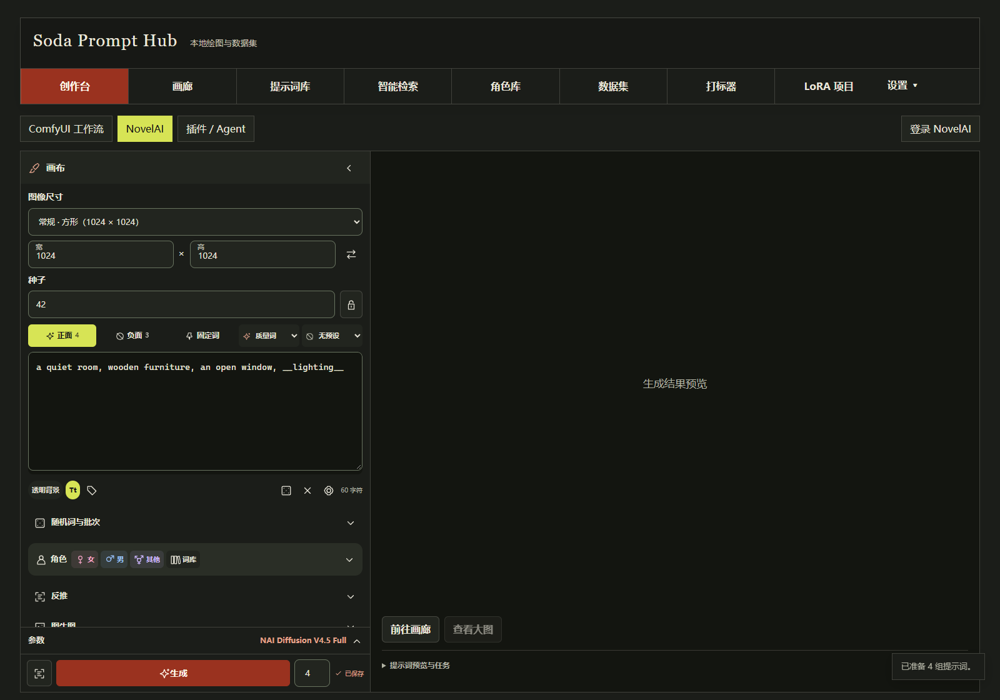

> 本文截图来自 1.3.0 实际运行界面，使用独立示例资料库。画廊和提示词库中的画作为导入参考，打标框线与描述为手工示例。示例素材来源见文末。

[安装与首次启动](#安装与首次启动) · [三种创作入口](#三种创作入口) · [提示词库](#提示词库) · [画廊](#画廊) · [数据集与打标器](#数据集与打标器) · [文档导航](#文档导航)

## 安装与首次启动

**版本状态（2026-11-17）**　当前分支为 `1.3.0`，Windows Desktop／Worker 安装包已构建，尚未发布到 GitHub Release。已公开的 Windows UI 安装包为 [1.2.0 预发布版](https://github.com/cOkieeman/soda-prompt-hub/releases/tag/v1.2.0-ui-20261012)，界面与本文有差异。可在[发行页](https://github.com/cOkieeman/soda-prompt-hub/releases)查看公开下载，提前运行 1.3 请使用本分支源码。

1. Windows x64 单机选择 `Soda-Prompt-Hub-Desktop-1.3.0-Setup.exe`。升级前备份个人资料并退出旧版服务，再运行安装器。
2. 安装包包含 Python、Node、Git 和 CPU 打标运行依赖，并按需安装 VC++ Runtime 与 WebView2。独立的 `Soda-Compute-Worker-1.3.0-Setup.exe` 用于另一台计算设备。
3. 打开 Soda Prompt Hub，等启动器显示 Core 就绪，再进入工作台。首次弹窗可勾选本地模型，也可以点「稍后再说」。
4. 按使用方式接入 ComfyUI 或 API，再到「创作台」试一张图。个人资料默认位于 `%USERPROFILE%\Documents\Soda Prompt Hub\prompt-library`，模型位于同级 `models`。

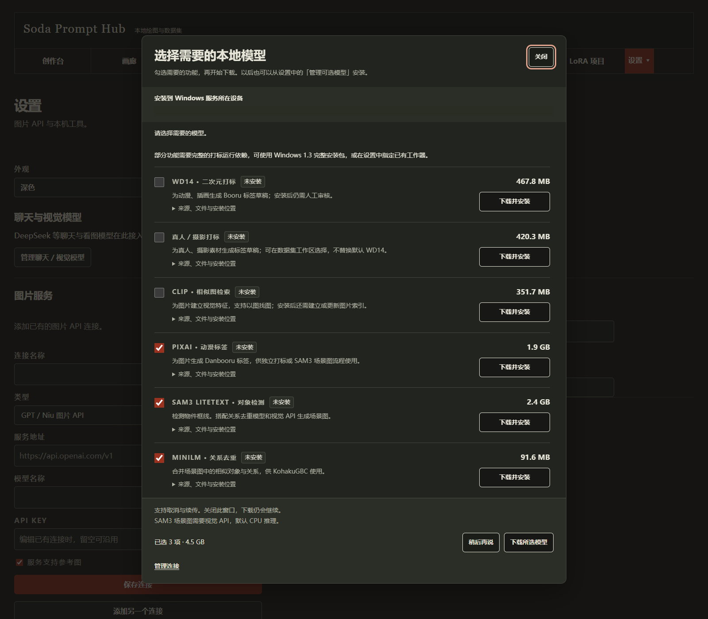

本地模型按用途选择。WD14／真人打标生成标签，CLIP 用于相似图检索，PixAI 生成动漫标签，SAM3 LiteText 检测物件框，MiniLM 合并相似对象与关系。勾选 SAM3 会同时勾选 MiniLM。场景图描述还需接入视觉模型 API。下载支持进度、取消、续传和 SHA-256 校验，完整清单见[可选本地模型](docs/OPTIONAL_MODELS.md)。

需要补装时打开「设置 → 设备连接 → 管理可选模型」。打标工作器默认使用 CPU，使用 NVIDIA GPU 时，在「设置 → 图片 API 与本机工具 → PixAI / KohakuGBC 标注工作器」指定已配置 CUDA 的 Python 环境并选择设备。批量打标由你在打标器提交。

## 三种创作入口

### ComfyUI 工作流

1. 启动自己的 ComfyUI，在「创作台 → ComfyUI 工作流」导入 **API 格式 JSON 工作流**，选择工作流并核对服务地址。ComfyUI 中所需节点和模型需已安装。
2. 分别填写「主题与风格、正文、负面词、后缀与署名」。常用参数与后处理按工作流呈现，节点映射可在「高级工作流设置」核对。
3. 需要批量变化时展开「随机词与批次」，选择手写、Wildcard 或 Raffle，管理词库并设置锁定项。先预览本批提示词，确认后点击「生成」，在队列和进度区查看状态。

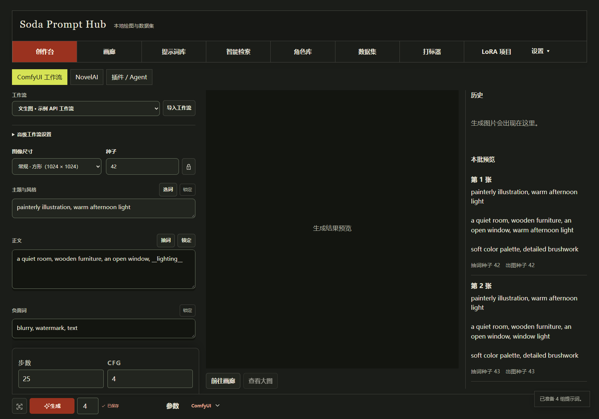

例如在随机词库 `lighting` 中每行填一种光线，在正文写 `a quiet room, __lighting__`。可选择每张重新抽词，或固定一组词只改变出图种子。Raffle 使用「设置 → 图片 API 与本机工具」中配置的本机 ComfyUI 词池目录。

### NovelAI

点击创作台顶部「NovelAI」，再点右上角「登录 NovelAI」。支持 Token 登录和邮箱／密码登录，第三方 NovelAI 图片服务从账号窗口的「第三方 API 连接」进入配置。登录后选择模型，填写正面、负面和固定词，再调整尺寸、种子与采样参数。

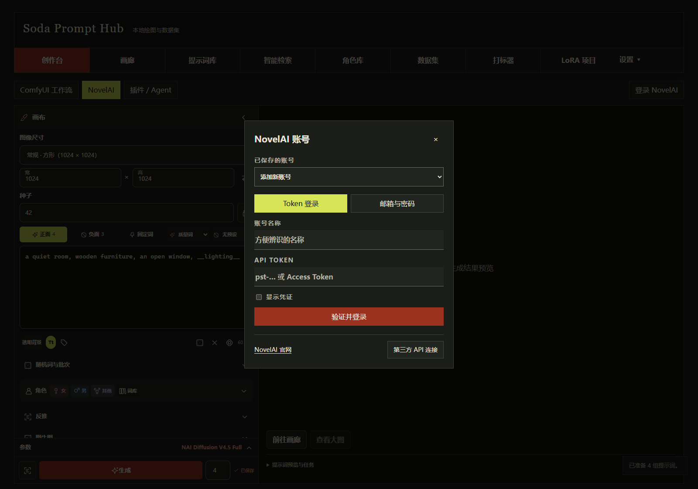

角色、图生图、局部重绘、扩图、风格迁移和精准参考在左侧展开；可用项随所选模型变化。参考图按对应区域加入，生成后可从结果区前往画廊。

### 插件／Agent

点击「插件／Agent」打开对话窗口。右侧「管理连接」可配置聊天／视觉模型和图片 API。聊天端点填写 Base URL、API Key 后可拉取模型，再勾选保存。图片服务在「设置 → 图片 API 与本机工具」填写，支持 GPT／Niu 类图片 API 和 NovelAI。

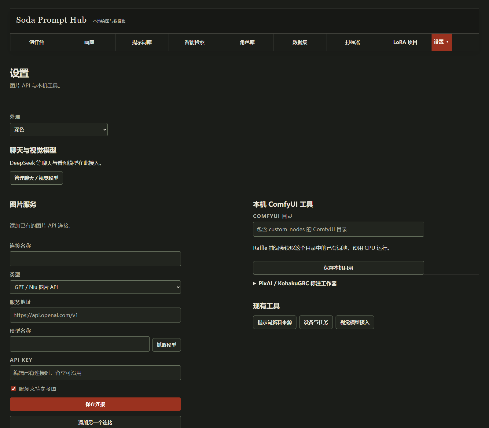

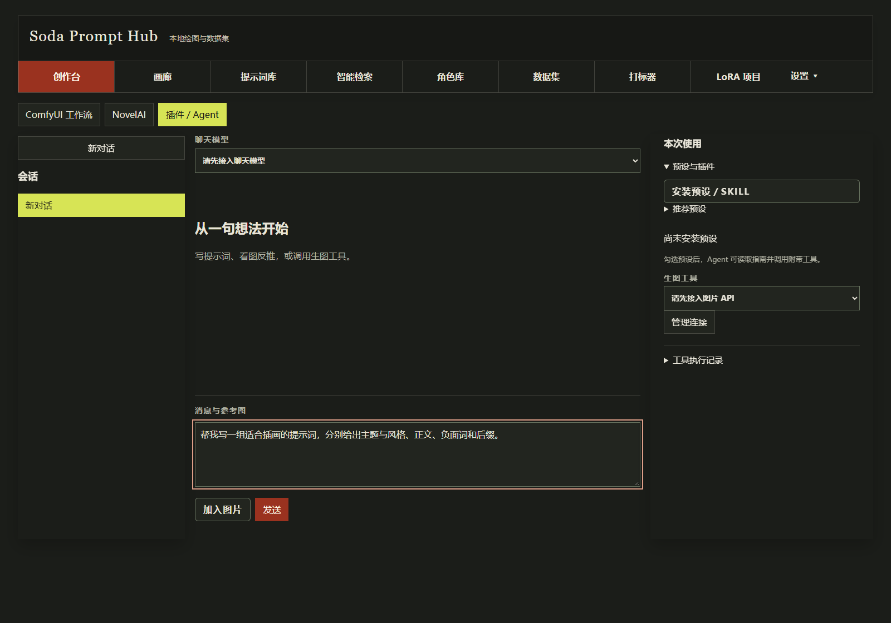

选择聊天模型，按需安装并勾选预设／Skill，再输入需求或加入参考图。Agent 可生成提示词，也可调用已接入的生图工具。Enter 发送，Shift+Enter 换行。预设提供提示指南，带工具的套件还需要相应运行依赖和连接配置，执行情况可在「工具执行记录」查看。

## 提示词库

按画风、角色、服饰与标签、完整提示词或修饰词筛选，点击卡片加入右侧组合。可调整权重与顺序、切换 NovelAI／SD 语法、复制原文，并选择字段「应用到创作台」。小图保留完整比例，查看详情后可打开大图。

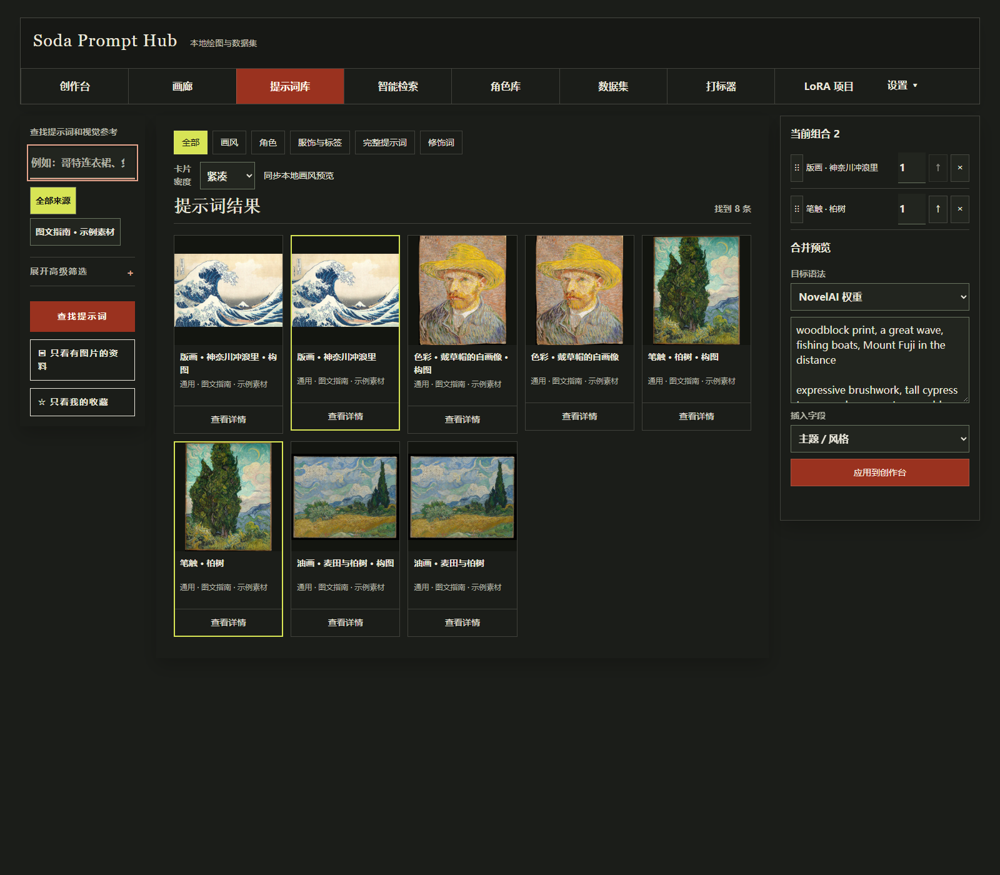

已有本地素材先在「设置 → 资料管理」接入，再通过「同步本地画风预览」更新。来源格式与支持的画风目录见[画风资料来源](docs/STYLE_SOURCES.md)。智能检索和角色库可从顶部导航进入。

## 画廊

ComfyUI、NovelAI、图片 API 和 Agent 的结果在本地画廊统一查看，可按生成来源筛选。也可添加图片或映射已有目录，整理作品、参考、图集和收藏。点击图片查看大图、提示词构成和可读取的生成记录。带 Hub 创作记录的图片可「送到创作台」，替换相应提示词字段。

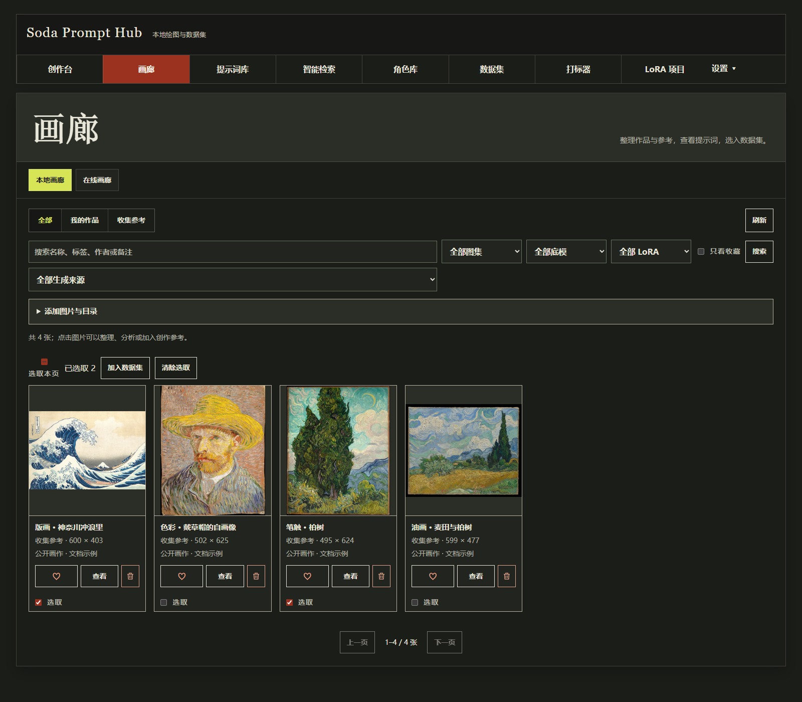

勾选图片后点「加入数据集」，选择已有数据集，或展开「建立新数据集」填写名称与训练目标。单图详情也有相同入口。

<details><summary>查看画廊加入数据集的操作窗口</summary>

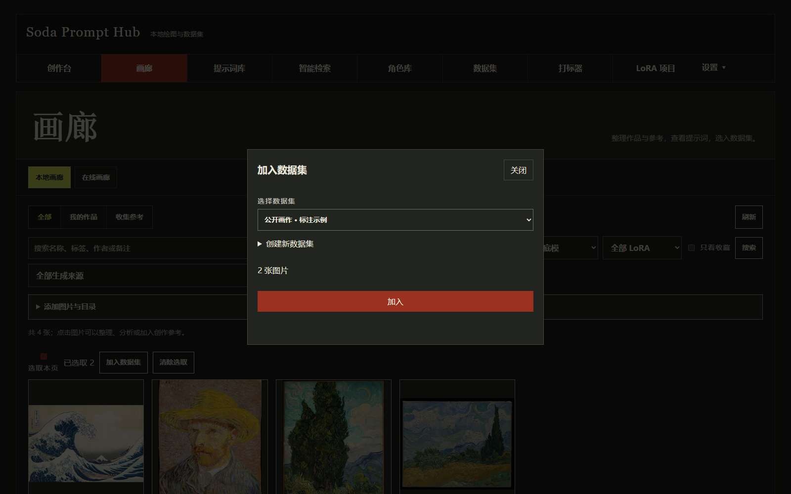

</details>

「在线画廊」提供 Danbooru、Safebooru、Gelbooru、AI TAG 与 QuickTagCloud 来源。使用 Danbooru 时，先选该来源，再展开下方「Danbooru 帐号」，填写用户名与 API Key，点击「验证并保存」。

## 数据集与打标器

1. 在「数据集」建立并命名项目，选择训练目标。可以从画廊选图、导入已有图片／文件夹／压缩包，也能前往创作台补图。
2. 在「图片与挑选」逐张采用或淘汰，检查近似图片。在「任务与记录」查看生成和标注任务。
3. 打开「标注与审核」，或从独立「打标器」进入同一项目。选择标注方式和视觉模型，生成草稿后逐图核对。

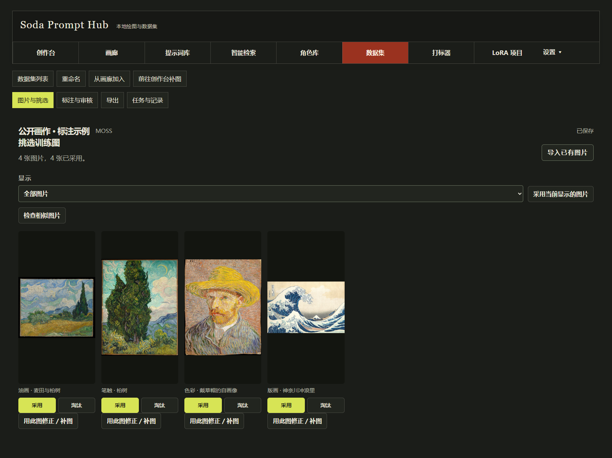

打标器左侧是图片列表，中间是可缩放画布，右侧是标签、描述、物件和关系。支持新增框线、拖动与缩放框、修改标签和关系、按置信度筛选、导入同名 TXT／JSON，以及导出标注 PNG。

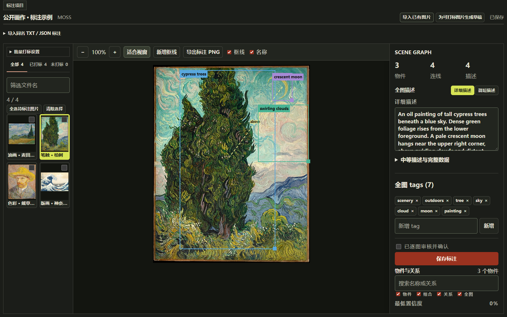

使用 **PixAI tags + KohakuGBC** 时，先由 PixAI 提供标签，SAM3 LiteText 检测物件，再通过所选视觉 API 生成描述和关系。先安装对应本地模型并配置视觉 API，完成后检查框线和内容，勾选「已逐图审核并确认」并保存标注。

在数据集「导出」选择格式并创建交付包，导出包含已采用且标注已确认的图片、标注与版本清单。

| 训练工具／用途 | 导出选择 |
| --- | --- |
| MOSS · KohakuMossTrainer | `MOSS 原生 GBC + JSON + TXT`，保留场景图并生成训练器数据配置 |
| Anima · Anima LoRA Studio | 按训练配置使用 TXT caption，或同时留存 JSON |
| Krea2／MiniMax H3 Image · Civitai | 按目标训练页面要求整理图片与 TXT caption |

TXT 保存文本说明，JSON 可保留标签、区域和关系等结构。MOSS 原生 GBC 使用专门的数据结构，Hub 会在导出时回读核对。交付包准备好后，交给对应训练工具配置训练参数。

<details><summary>查看训练集导出界面</summary>

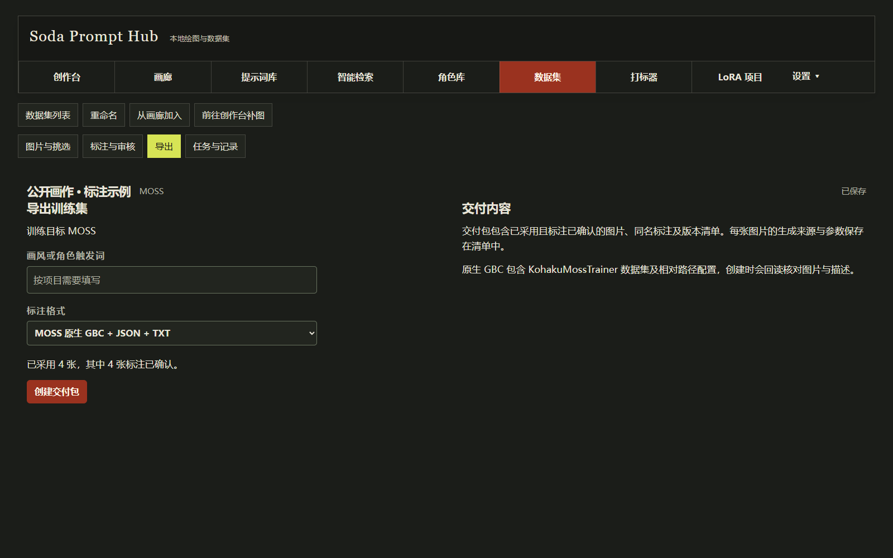

</details>

## 文档导航

| 需要了解的内容 | 文档 |
| --- | --- |
| 安装、升级、启动器与排错 | [快速开始](docs/QUICK_START.md) · [安装说明](docs/COMMERCIAL_RELEASE.md) · [故障处理](docs/TROUBLESHOOTING.md) |
| 出图、素材与数据集操作 | [核心工作流](docs/WORKFLOWS.md) · [创作辅助](docs/CREATIVE_AI_GUIDE.md) · [详细使用手册](docs/USER_MANUAL_DRAFT.md) |
| 资料来源与可选模型 | [画风来源](docs/STYLE_SOURCES.md) · [模型下载](docs/OPTIONAL_MODELS.md) |
| 其他平台与多机连接 | [Mac 使用](docs/MAC_GUIDE.md) · [Windows Worker](docs/WINDOWS_WORKER.md) · [Linux 实验性支持](docs/linux/README.md) · [文件与设备关系](docs/ARCHITECTURE.md) |
| 版本、产品与开发 | [版本体系](docs/RELEASES.md) · [Desktop 计划](docs/DESKTOP_PRODUCT_PLAN.md) · [界面规格](docs/DESKTOP_UI_SPEC.md) · [开发计划](DEVELOPMENT_PLAN.md) |

## 从源码运行

```bash
git clone --branch codex/v1.3-creation-dataset-tagger https://github.com/cOkieeman/soda-prompt-hub.git
cd soda-prompt-hub
uv sync
uv run --no-sync prompt-hub serve --host 127.0.0.1 --port 8765
```

在浏览器打开 `http://127.0.0.1:8765`。可通过 `PROMPT_HUB_LIBRARY_ROOT` 和 `PROMPT_HUB_MODELS_ROOT` 指定资料与模型目录。源码运行的 PixAI／KohakuGBC 工作器及 MOSS 原生导出需安装对应可选依赖，见[模型与依赖说明](docs/OPTIONAL_MODELS.md)。本轮 Windows 1.3 安装包包含 CPU 依赖，Mac 使用现有发行版，Linux 由社区实验性适配提供。

## 许可证与示例素材

代码采用 [MIT License](LICENSE)。第三方图片、提示词、模型、工作流和数据集沿用各自来源的许可证与使用条款。

截图中的公共领域画作来自 The Metropolitan Museum of Art 的开放资源，包括[麦田与柏树](https://www.metmuseum.org/art/collection/search/436535)、[柏树](https://www.metmuseum.org/art/collection/search/437980)、[戴草帽的自画像](https://www.metmuseum.org/art/collection/search/436532)与[神奈川冲浪里](https://www.metmuseum.org/art/collection/search/45434)。截图中的示例词条、手工标注与空白连接供操作演示使用。
