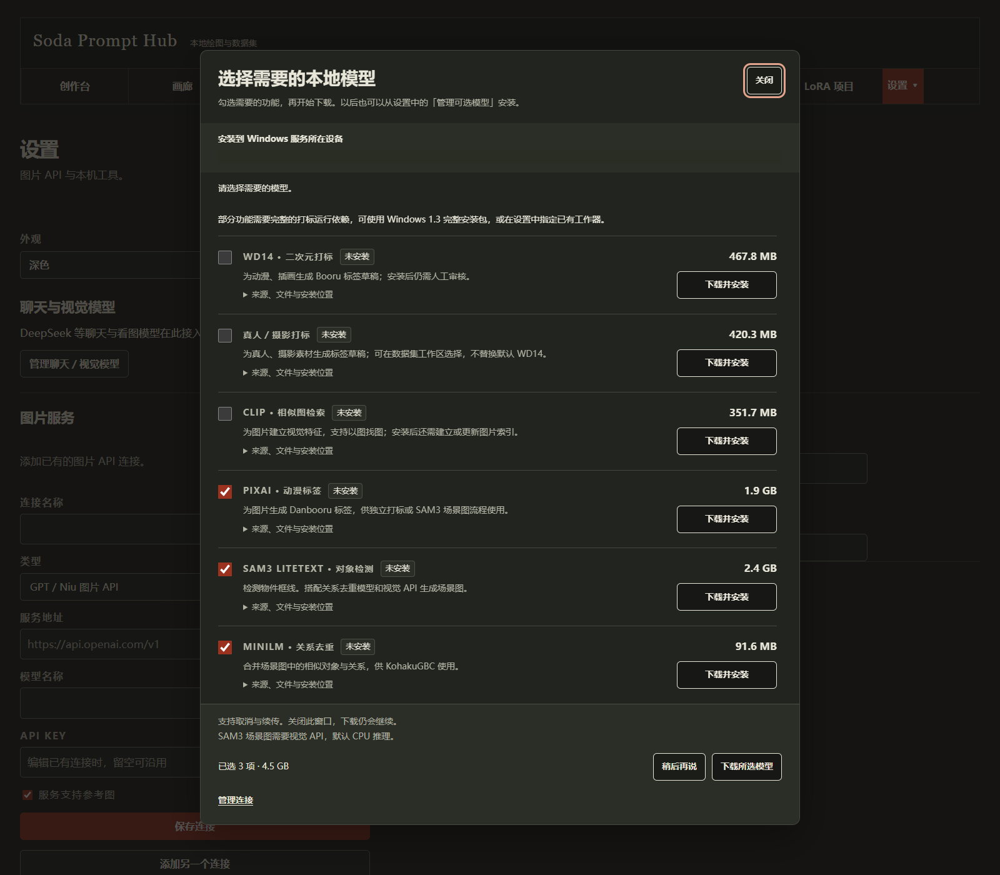

# 可选本地模型

1.3 首次进入工作台会显示模型选择窗口。按需要勾选后点击「下载所选模型」，也可以「稍后再说」。后续从「设置 → 设备连接 → 管理可选模型」重新打开。



## 按用途选择

| 模型 | 用途 | 完整下载大小 |
| --- | --- | --- |
| WD14 / wd-swinv2-tagger-v3 | 二次元与插画 Booru 标签草稿 | 约 468 MB |
| idolsankaku-swinv2-tagger-v1 | 真人与摄影标签草稿 | 约 420 MB |
| CLIP / clip-vit-base-patch32 | 相似图检索，安装后建立或更新图片索引 | 约 352 MB |
| PixAI / pixai-tagger-v1.0 | 动漫 Danbooru 标签，也可作为场景图流程的第一步 | 约 1.9 GB |
| SAM3 LiteText L | 根据标签检测物件框线，供 KohakuGBC 使用 | 约 2.4 GB |
| all-MiniLM-L6-v2 | 场景图中相似对象与关系的嵌入、合并 | 约 92 MB |

勾选 SAM3 会同时勾选 MiniLM。需要「PixAI tags + KohakuGBC」完整流程时，选择 PixAI、SAM3 LiteText 和 MiniLM，并另外接入可看图的模型 API。

SAM3 LiteText L 使用固定版本的 `vil-uob/sam3-litetext-l`。如果自行配置官方 `facebook/sam3` 权重，需要按来源要求取得访问授权。来源、版本、文件和安装位置可在每张模型卡片中展开查看。

## 安装位置与下载

模型安装到运行 Core 服务的设备。默认目录是用户文档中的 `Soda Prompt Hub/models`，也可通过 `PROMPT_HUB_MODELS_ROOT` 指定。窗口显示实际绝对路径，远程浏览器访问时也以该服务端路径为准。

下载任务显示排队、已下载字节数、百分比与 SHA-256 校验状态。可以逐项安装、取消、续传和重试，关闭弹窗或刷新页面后可重新查看任务。部分模型还会执行本地加载或推理自检，具体进度以模型卡片为准。

需要可访问 Hugging Face 的网络和足够磁盘空间。下载器使用清单中固定版本的模型文件。发现已有文件时会先检查，版本不匹配的自定义模型可以继续通过工作器设置接入。

Windows 1.3 完整安装包包含 CPU 打标运行依赖。PixAI、SAM3 和 MiniLM 安装验证完成后，会补全工作器中尚未填写的对应路径。请在「设置 → 图片 API 与本机工具 → PixAI / KohakuGBC 标注工作器」核对 Python、模型目录和设备。

## 源码运行依赖

在项目根目录运行以下命令安装 PixAI／KohakuGBC 工作器依赖与 MOSS 原生导出依赖。

```bash
uv sync --extra captioning --extra moss
uv run --no-sync prompt-hub serve --host 127.0.0.1 --port 8765
```

在标注工作器设置中将「工作器 Python」指向该环境的 Python，Windows 通常为项目内 `.venv\Scripts\python.exe`。模型权重通过前述弹窗单独下载。

Windows 的项目依赖默认选择 CPU Torch。使用 NVIDIA GPU 时，在已有匹配 CUDA 的独立工作器环境中安装所需依赖，填写其 Python 路径并选择「NVIDIA GPU」。先用少量图片检查模型加载与显存使用，再开始批量任务。

## 视觉模型与手动安装

聊天与视觉模型从 Agent 的「管理连接」，或「设置 → 图片 API 与本机工具 → 管理聊天／视觉模型」接入。填写服务地址、凭证、拉取并保存模型后，在打标器选择视觉模型。场景图描述会将图片发送到所选视觉 API。

手动安装可按卡片中的文件清单放到所示目录，再回到窗口执行校验。WD14／真人模型需要 `model.onnx` 与 `selected_tags.csv`，CLIP 需要 `vision_model.onnx`。PixAI、SAM3 和 MiniLM 需要各自清单中的完整文件。

标签、框线、描述和关系以待审核草稿进入项目，逐图确认后再导出。各模型的许可与使用条款见其来源页面。
